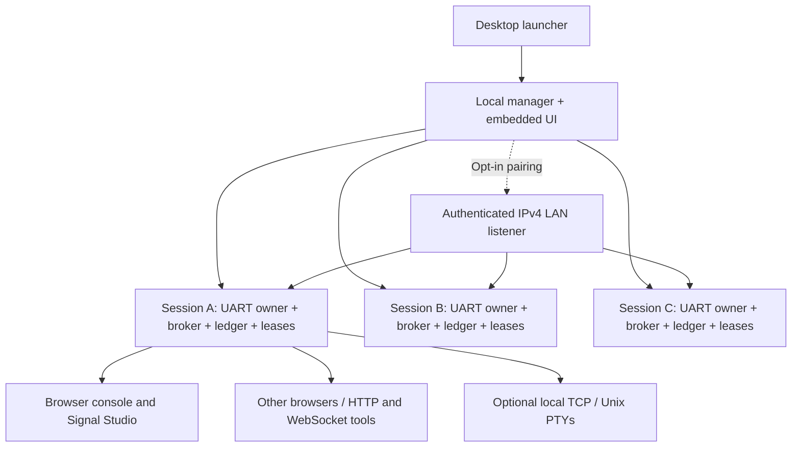

# Desktop device manager

The lifecycle behavior below is implemented in the v0.3.0 source/candidate builds.
The current published v0.2.3 packages predate native tray support.

Run `serialhub-desktop` (Windows: `.exe`, macOS: `SerialHub.app`) or run
`serialhub` with no arguments. The browser opens automatically. The application
contains the UI and HTTP/WebSocket server. There is no cloud service or runtime
Node.js dependency. The process runs on the computer connected to the hardware.

## Opening, hiding and quitting

Double-click the launcher to open the browser workspace. The launcher returns after
startup; the owner service has its own process and diagnostics, so closing the
launching terminal does not stop it. Repeated launches reopen the same instance,
including when another program occupies port 8787 and a fallback port was selected.

- **Windows:** double-click the notification-area icon to reopen the workspace;
  right-click it for **Open workspace**, **Open diagnostics** and **Quit SerialHub**.
- **macOS:** use the menu-bar icon. Opening `SerialHub.app` again reopens the
  existing workspace instead of creating another owner.
- **Linux:** the StatusNotifierItem tray menu provides the same actions without
  GTK/AppIndicator dependencies. GNOME installations may need a tray extension;
  the default launcher also installs **SerialHub** and **Quit SerialHub** entries
  in the user's application menu, so quitting does not depend on tray visibility.
  After moving a portable folder, run its launcher to refresh these entries.
- **Every browser workspace:** click the SerialHub brand/menu indicator for the
  application menu. **Quit SerialHub** asks for confirmation before closing devices.
  Paired LAN browsers cannot quit the host or open its diagnostic files.

Closing the browser page keeps device owners and opt-in LAN sharing running.
Browser-side recording, timed sends and visualization stop when that page closes;
minimize its browser window to preserve that browser work. Reopening the app starts
fresh browser acquisition while preserving the host's sessions and bounded RX history.
Use **Quit SerialHub** to stop the service, cancel active jobs, revoke LAN sharing
and release all device handles. Open browsers receive a final stopped event. New
writes are rejected as soon as shutdown starts; old status responses cannot revive
an already stopped workspace. Quit does not finish queued file transfers.

The app menu and native tray follow the language selected on the local host's
web page; remote browser language changes do not change the host's native menu.
Diagnostics are private to the OS user and bounded to a current/previous log of
about 4 MiB each (rotation is checked every two seconds). Desktop mode does not
mirror serial payloads into these diagnostics.

For a headless host or fixed port:

```sh
serialhub desktop --foreground --no-browser --bind 127.0.0.1:8787
```

Optional commands remain available:

```sh
serialhub desktop --background --no-browser  # detached, no browser launch
serialhub --status                           # status of the default GUI instance
serialhub --quit                             # exit the default GUI instance
serialhub quit --bind 127.0.0.1:8787          # exit a chosen instance
```

`--no-browser` on its own preserves the previous foreground/headless behavior;
add `--background` for an independent process. Container PID 1 stays in the
foreground so the container does not exit when a GUI launcher would return.
Application data defaults to `%LOCALAPPDATA%/SerialHub` on Windows,
`~/Library/Application Support/SerialHub` on macOS, and
`~/.local/share/SerialHub` on Linux. `SERIALHUB_STATE_DIR` can select an absolute,
private state directory for isolated deployments and tests. Discovery verifies
an instance nonce and never kills a process by a saved PID.

The default is loopback port 8787. If occupied, the manager selects a free port
and opens the correct URL. Repeated launches reuse a manager already listening at the requested
address. Managers on different explicit ports remain independent; do not open the
same hardware from different manager processes. Use **Quit SerialHub** to stop an instance. The OS must permit the downloaded executable to run.
Linux packages require glibc 2.39+; Windows virtual COM drivers are separate.

## Device lifecycle and architecture



The manager mounts existing session API routers under `/sessions/{id}`;
there are no extra HTTP ports per device. Serial I/O remains on dedicated
owners. Registry operations serialize device creation/close and reserve an
owner until shutdown completes; data streams do not take this registry lock.
Each session has a separate broker, policy, ledger, workflow runner and cancellation
token. Creation rejects duplicate canonical device paths (including Unix symlinks,
macOS callout aliases and Windows COM case), invalid settings and more than 16 sessions.
TCP and PTY resources are prepared before opening hardware; failed binds roll back.

**Created** means the owner is running, not that the hardware successfully opened.
The inventory displays the owner's connected/offline state and OS diagnostic;
reconnect continues while the session exists. Closing cancels its browser streams,
releases endpoints and stops the owner. Existing subscribers to other devices continue.
In an open workspace, use the device menu in the original top navigation to switch
between sessions; choose **All devices** in that menu to return to the manager.
The manager's header is hidden while a workspace is open. Language selection and
connection status stay in the single workbench header. Switching preserves acquisition,
drafts, the selected tool and explicit send jobs in already visited workspaces. Closing the browser stops browser jobs, but keeps host sessions alive.
Reloading a browser retains the host inventory but starts fresh browser acquisition.
Sessions are not automatically reopened after exiting/restarting the application.

The ledger uses bounded memory (up to 32 MiB / 16,384 events per session); this GUI
mode does not enable persistent disk evidence. Use the existing TOML/CLI mode for
persisted ledgers, RFC2217, custom policies, USB identity selection, serial bridges,
and deployments with tailored endpoint permissions. Desktop mode provides full
browser debugging and signal tooling; it does not expose every deployment setting.
No hardware/driver qualification or universal desktop OS support is implied by mock tests.

## Sharing

A session broadcasts one shared RX byte stream. Replies are not privately routed
back to the sender. Acquire a write lease for protocols needing a coordinated
request/response transaction. Other writers are rejected while the lease is active.
Optional local TCP listeners accept multiple programs; default line framing matches
CLI text mode. Use CLI `--tcp-raw` for binary TCP bridges. PTYs are Unix-only.
Windows tools demanding COM ports still require a COM pair driver and bridge.

The UI's **Enable LAN sharing** opens a separate ephemeral IPv4 listener.
The local listener remains local. Share the generated URL only on a trusted LAN:
its fragment contains an unguessable, per-enable pairing credential. The fragment
is removed from browser history before API requests; it is never put in HTTP query
strings. Pairing installs an HttpOnly, SameSite=Strict session cookie. Paired users
can open/close devices and use the session APIs, but only the local listener may
change LAN settings or quit the process. HTTP is unencrypted; this is not an
Internet-facing or multi-user authorization service. Host/origin checks apply before
dispatch. Disabling sharing invalidates the credential and cancels remote streams;
re-enabling generates a new credential. Local session streams continue.

The link uses the primary routed IPv4 address. With multiple interfaces, replace
its IP with the device host's appropriate LAN IPv4 address. A VPN or firewall may
require configuration. LAN DNS names, IPv6 listeners and automatic NAT traversal
are not provided by this mode.

## API

| Method / path | Purpose |
| --- | --- |
| `GET /manager/info` | Identity, capabilities, session status; LAN link only on local listener |
| `GET /manager/ports` | Scan ports on the device host |
| `POST /manager/sessions` | `{path, name?, settings, tcp_port?, pty_count?}`; returns session ID |
| `DELETE /manager/sessions/{id}` | Stop one device and its clients |
| `POST /manager/lan` / `DELETE /manager/lan` | Enable/revoke sharing locally |
| `POST /manager/pair` | `{code}` on LAN listener; install session cookie |
| `POST /manager/quit` | Stop manager and devices locally |
| `/sessions/{id}/v1/*` | Existing session HTTP/WebSocket API, including leases and workflows |

Non-browser LAN tools may send `Authorization: Bearer <pairing-code>` or WebSocket
subprotocols `bearer, <pairing-code>`. Preserve same-origin headers for browsers.
Tokens must never be written into device payloads. Existing standalone `run`,
`share`, `supervise`, replay and COM bridge command contracts remain available.

## Verification

- `dbus-run-session -- python scripts/smoke-launcher.py --binary target/release/serialhub-desktop --check-tray`:
  exercise the actual Linux D-Bus tray icon/menu, language update, browser-open
  callback and native quit action with two mock owners.
- `python scripts/smoke-launcher.py --binary PATH`: verify extracted GUI launcher
  detachment, repeated-launch reuse, explicit shutdown and listener release.
- `cargo test --locked --all-targets`: native gateway tests open two mock owners,
  fan out actual WebSocket bytes, reject cross-device leases, close/reopen one owner,
  verify LAN authentication/revocation and test occupied-port fallback.
- `npm --prefix web test`: protocol, connection, capture, signal and localization contracts.
- `npm --prefix web run test:e2e`: legacy embedded workspace plus manager flows,
  independent browser state, pairing links/cookies, revocation, desktop fit and mobile.
- Release CI runs tests on six native OS/architecture combinations, builds all three
  executables, validates architectures/checksums and runs the extracted packages.
  The macOS app's embedded executable is also architecture/version checked.

For hardware acceptance, use two physical adapters, observe RX on two clients per
adapter, test leases, unplug/replug each separately, and confirm closing one device
leaves the other running. Test drivers, DTR/RTS/reset behavior, high sustained baud
rates and private-network firewall access on your actual Windows/macOS/Linux hosts.
