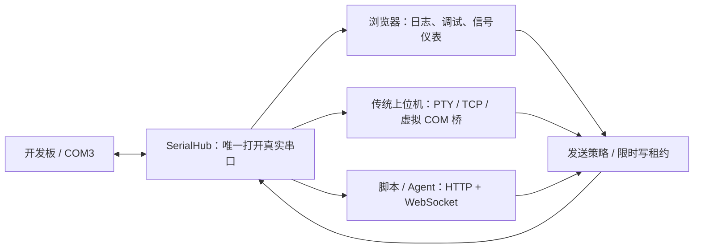

# SerialHub：解决什么问题、怎么用、怎么验收

## 1. 产品定位

**SerialHub 是给嵌入式开发者使用的本地串口共享服务，配有调试和信号分析界面。**

典型用户是同时使用上位机、日志窗口、Python 测试脚本或 AI Agent 的固件、硬件和测试工程师。

例如，一块开发板连接电脑的 `COM3`：工程师要查看日志，曲线工具要看传感器数据，测试脚本还要发送命令。通常一个程序打开 `COM3` 后，其他程序就无法打开；反复关软件、重新连接又会打断调试。

SerialHub 统一持有 `COM3`，其他程序改连它提供的接口：



| 使用需求 | Hub 如何处理 | 使用者需要知道 |
| --- | --- | --- |
| 多程序看同一个设备 | 将设备接收数据广播给有读取权限的客户端 | 慢客户端可能丢数据或被断开；关注丢弃指标与账本 |
| 多程序发送命令 | 按行/帧排队，或要求独占写租约 | 发送顺序受仲裁，不代表设备协议支持多个同时进行的事务 |
| 一段测试不能被打断 | 获取租约，持 token 写入，完成后释放 | 其他写入被拒绝；长任务需在到期前续租 |
| 排查谁发了什么 | 查询 RX/TX、拒绝、连接等事件 | 需要长期保存时配置账本持久化 |
| 看波形和测量 | 浏览器示波、FFT、XY、仪表与 CSV 回放 | 设备必须输出正确协议，并填写真实采样率 |

**共享的是同一条字节流。** 设备回复会广播给各个读者；Hub 不会自动识别“这条回复属于 Python，那条属于上位机”。要求严格请求/响应配对时，应让一个程序持有租约完成整个事务，或在设备协议中使用请求 ID。`--tcp-raw` 保留的是一次 TCP 读取的写入单元，TCP 读取边界不是设备协议帧边界。

SSCOM 类调试功能与 VOFA 类信号分析，是共享服务上的操作界面。核心使用理由是让这些工具和自动化协同工作。只用一个程序偶尔收发串口时，直接使用普通串口助手也足够；多工具同时工作时，Hub 的价值最明显。

## 2. 不输入命令，直接使用

下载 v0.2.0 或更新版本的对应平台包，解压后：

- **Windows**：双击 `serialhub-desktop.exe`，没有命令窗口。
- **macOS**：打开 `SerialHub.app`。
- **Linux**：在文件管理器中将 `serialhub-desktop` 作为程序运行；文件需要可执行权限。

v0.3.0 源码/候选包增加了系统托盘：Windows 右键托盘图标、macOS 点击菜单栏图标、Linux 使用支持 StatusNotifierItem 的托盘，可以重新打开工作台、打开日志和退出。Linux 默认启动器也会创建应用菜单中的“SerialHub”和“Quit SerialHub”入口。
工作区点击 SerialHub 品牌旁的菜单标记，也可确认退出全部设备。关闭网页只关闭浏览器端工作；设备服务继续运行。退出旧版本后再启动新版，避免复用旧版后台。

浏览器会自动弹出。首页选择串口、设置波特率等参数，再点 **Open workspace（打开工作区）**。
工作区顶部保留一条功能导航；右侧设备下拉菜单可切换串口，选择 **All devices（所有设备）** 返回设备管理首页。
切换时，各设备的连接、日志、草稿及当前功能页会保留。
没有硬件就点 **Try demo（试用演示）**。界面默认英文，右上角可切换繁体中文、西班牙语、法语、阿拉伯语或简体中文。
普通使用者无需安装 Rust、Node.js、Python 或启动另一个网页服务。

返回 **All devices（所有设备）** 可以再打开其他串口，最多同时运行 16 个独立会话。
每个会话分别持有一个串口、数据流、事件账本和写入租约；一个串口也能被多个网页或工具同时订阅。
切换标签保留浏览器连接和草稿。关闭网页不会停止后台设备；请用首页 **Close session（关闭会话）** 释放串口，用 **Quit SerialHub（退出 SerialHub）** 停止整个程序。

需要其他电脑访问时，在连接硬件的电脑上点 **Enable LAN sharing（启用局域网共享）**，复制配对链接给同一可信 IPv4 局域网内的浏览器。
浏览器不需要再次安装 SerialHub。持有链接的人可管理设备会话并收发命令；主机可随时关闭共享，远端连接随即中止，本机串口继续运行。
共享使用 HTTP，系统防火墙需允许此程序；多网卡时可把链接中的 IP 改成对应主机 IPv4 地址。

首页 **External tools（外部工具）** 可选配本地 TCP 端口，macOS/Linux 还能创建最多四个虚拟 PTY。
在工作台 **Connections（连接）** 查看地址；一个 TCP 端口可以接多个程序。
Windows 的传统软件若必须使用虚拟 COM，仍需安装虚拟 COM 驱动并配置桥接；网页使用流程不需要虚拟 COM。

下载包尚未进行代码签名，操作系统可能要求确认允许打开。真实串口仍需设备驱动和系统访问权限。
首次打开失败时首页会显示离线与驱动错误，不会把创建会话误报成硬件已连接。

## 3. 从源码构建或使用命令

命令仍然支持，也适合自动化。下面是原有单 Hub 演示；源码开发需要 Rust 和 Node.js，普通下载用户不需要。


以下命令在仓库根目录执行。构建需要 stable Rust、Node.js 22.18+ 或 24+；Linux 使用系统串口接口，不强制依赖 libudev 开发包。首次安装依赖需要网络。

```bash
npm --prefix web ci
npm --prefix web run build
cargo build --locked --release --bin serialhub
./target/release/serialhub share mock:demo --pty 0 --tcp 1 --tcp-raw --ui
```

Windows 使用 `.\target\release\serialhub.exe`；已下载包含本轮功能的二进制时，直接运行最后一条命令即可。源码中的新增功能不代表旧版 Release 下载包已经包含它们。

浏览器访问 **http://127.0.0.1:8787/**，连接主机 `127.0.0.1`、端口 `8787`、HTTP。这个演示未配置令牌，输入留空。若端口已被占用，先停止旧 Hub，或同时更改启动参数和网页连接端口。

桌面工作台按窗口高度排列，建议使用 1366×768 或更大的窗口：顶部是连接、设备状态和租约；左侧是终端与波形；右上是发送区，右下通过“设备参数 / 快捷指令 / 工具箱 / 协议帧”切换工具。日志和较长工具内容在各自区域内滚动，切换工具保留草稿与已选择文件。信号仪表页左侧显示示波与数值，右侧通过标签切换 FFT、XY、瀑布等；选择“全部仪表”后还可切换姿态和参数控制。“通道与数据帧配置”“原始数据表”“连接配置”在弹窗中打开，按 Escape 或关闭按钮返回。窄于 1000 像素的窗口保留纵向布局，方便手机触控。

1. 在“实时工作台”发送 `hello`，选择 LF 行尾，应收到 `hello` 回环。
2. 再打开第二个浏览器窗口并连接。任意窗口发送 `hello-2`，两个窗口都应收到它。
3. 在“连接与端点”查看 TCP 地址 `127.0.0.1:8788`；脚本或支持网络连接的上位机连接这个地址。
4. 在“事件与指标”检查对应 TX/RX 记录。Mock 会把发送字节原样回送，真实设备是否回复由固件决定。

### 看一段可检查的波形

在“信号仪表”选择 **FireWater CSV**，设备采样率填写 **1024 Hz**，FFT 选择 **1024 点**。下面的 Python 3 示例仅允许连接 Mock，在另一个终端运行；使用 Windows 时可将代码保存为 `demo-signal.py` 后运行 `python demo-signal.py`。

```python
import json
import math
import time
from urllib.request import Request, urlopen

base = "http://127.0.0.1:8787"
with urlopen(base + "/v1/status", timeout=3) as response:
    status = json.load(response)
if not status["port"]["path"].startswith("mock:"):
    raise SystemExit("这个示例只向 Mock 写入，请启动 mock:demo")
for start in range(0, 16384, 64):
    rows = []
    for i in range(start, start + 64):
        t = i / 1024
        rows.append(f"{math.sin(2*math.pi*64*t)},{0.5*math.cos(2*math.pi*64*t)}\n")
    request = Request(base + "/v1/write",
                      data=json.dumps({"text": "".join(rows)}).encode(),
                      headers={"Content-Type": "application/json"})
    with urlopen(request, timeout=3) as response:
        if not json.load(response).get("ok"):
            raise SystemExit("写入被拒绝，请检查租约和连接状态")
    time.sleep(64 / 1024)
```

预期：两条波形，FFT 主峰约 **64 Hz**，XY 为椭圆。可以冻结、放大、设置游标，再导出 CSV/PNG。这里的时间轴来自设定的采样率；Python 的发包间隔不是硬件采样时钟。

## 4. 接上真实设备

Hub 必须运行在**插着 USB 串口的电脑上**。浏览器连接 Hub；云服务器无法凭浏览器页面自动打开你电脑的 `COM3`。

先关闭正在独占真实端口的软件，用 `serialhub list-ports` 确认设备，然后按系统启动：

```bash
# Windows（PowerShell）
.\target\release\serialhub.exe share COM3 --baud 115200 --tcp 1 --tcp-raw --ui

# Linux
./target/release/serialhub share /dev/ttyUSB0 --baud 115200 --pty 2 --tcp-raw --ui

# macOS：以 list-ports 的实际结果为准
./target/release/serialhub share /dev/cu.usbserial-XXXX --baud 115200 --pty 2 --tcp-raw --ui
```

波特率、校验、数据位、停止位和流控必须与设备一致。长期使用时保存 TOML，Linux 优先选择稳定的 `/dev/serial/by-id/...` 路径；用 `serialhub check -c device.toml` 预检后再 `serialhub run -c device.toml`。

| 现有程序 | 接入方法 |
| --- | --- |
| 浏览器工作台 | 访问 Hub 的 HTTP 页面 |
| Python / Agent | HTTP 写入，WebSocket 订阅 RX；需要事务独占时使用 `/v1/lock` |
| 支持 TCP 的上位机 | 连接 Hub 的 TCP 端点，默认 `127.0.0.1:8788` |
| Linux/macOS 串口软件 | 打开 Hub 打印的 PTY 路径，每个串口软件使用独立 PTY |
| Windows 只认 COM 的软件 | 使用已安装的虚拟 COM 对配合 `bridge-com`，见下例 |

Windows 示例：真实设备是 `COM3`，已安装的虚拟串口驱动提供 `COM12 ↔ COM13`。

```powershell
# Hub 已经持有 COM3；另开一个终端
.\target\release\serialhub.exe bridge-com COM13 --tcp 127.0.0.1:8788 --baud 115200
# SSCOM 等软件打开 COM12；不要再打开真实 COM3
```

每个只认 COM 的独立软件需要自己的虚拟 COM 对和桥接进程。项目不自带 Windows 虚拟串口驱动，安装和操作详见 [Windows COM 桥接](./WINDOWS_COM_BRIDGE.md)。

真实设备绘图时，让固件输出例如 `1.2,3.4\n` 的 FireWater 或受支持的 JustFloat 帧。普通文字日志不能自动变成有效测量曲线；自定义二进制需配置数值类型、通道数、字节序和帧头。详见 [VOFA 功能与计算约定](./VOFA_PARITY.zh-CN.md)。

## 5. 怎么测试：先共享，再交互，最后实机

### 一条命令验证核心共享链路

```bash
python3 scripts/smoke-sharing.py
# Windows 也可以：python scripts/smoke-sharing.py
# 指定其他二进制：python3 scripts/smoke-sharing.py --binary /path/to/serialhub
```

脚本只需 Python 3 标准库，会自动启动独立 Mock Hub，选择空闲回环端口；不连接已有 Hub，不打开硬件，结束后清理进程和临时目录。成功应输出 `SHARING_SMOKE_OK`，失败以非零退出码结束。

它实际检查：两个 TCP 客户端同时收到完全一致的二进制 RX；持租约后，没有 token 的同名程序也无法写入；释放租约后，另一个 TCP 程序可以写入，两个读者都能收到回环。它不代表穷尽并发、慢客户端或硬件情况。

### 自动化回归

在仓库根目录执行，保持 Cargo 在 PATH；浏览器测试使用独立端口 `18887`：

```bash
npm --prefix web test
npm --prefix web run lint
npm --prefix web run build
cargo fmt --all -- --check
cargo clippy --locked --all-targets -- -D warnings
cargo test --locked --all-targets
npm --prefix web exec -- playwright install chromium
npm --prefix web run test:e2e
```

若系统已有兼容 Chromium，Linux 可替换最后两条为：

```bash
PLAYWRIGHT_CHROMIUM_EXECUTABLE=/usr/bin/chromium npm --prefix web run test:e2e
```

| 测试层 | 验证内容 | 不能证明的事情 |
| --- | --- | --- |
| Rust 单元/集成 | 仲裁、租约、权限、断线世代、账本、接口、关闭等 | USB 驱动和电气层可靠性 |
| 前端单元 | 编码/校验、解析分片、FFT 已知频率与幅度、CSV、缓存边界 | 实际浏览器交互 |
| 浏览器 + Mock Hub | 连接、收发、文件与轮发、曲线、触发、回放、像素、窄屏等 | 真设备时序与长时间稳定性 |
| 硬件在环 | 目标电脑 + 转接器 + 固件的实际组合 | 其他未经测试的硬件组合 |

### 真实设备验收清单

| 操作 | 通过标准 |
| --- | --- |
| 同时连接页面、上位机、脚本 | 只有 Hub 打开真实口；各方都能收到设备发出的编号数据 |
| 发送无副作用的查询指令 | 收到设备协议定义的正确回复；HTTP 成功仅说明主机侧写入与 flush |
| A 持租约、B 尝试写入 | B 明确失败；释放后 B 才能写入 |
| 拔掉并插回设备 | 状态显示断开/恢复；旧命令不自动重发，界面自动发送保持关闭 |
| 目标波特率持续运行 | 按设备编号或 CRC 检查缺帧；记录 RX 丢弃、重连、CPU、内存和磁盘情况 |
| 突然关闭某个客户端 | 其他读者仍工作；恢复后重新验证会话和租约 |

长稳时长应由设备风险和使用周期决定，并保存 OS、转接器型号、固件、速率和测试记录。完整边界见 [可靠性测试矩阵](./RELIABILITY_TEST_MATRIX.md)；部署、认证和故障处理见 [运行指南](./OPERATIONS.md)。
