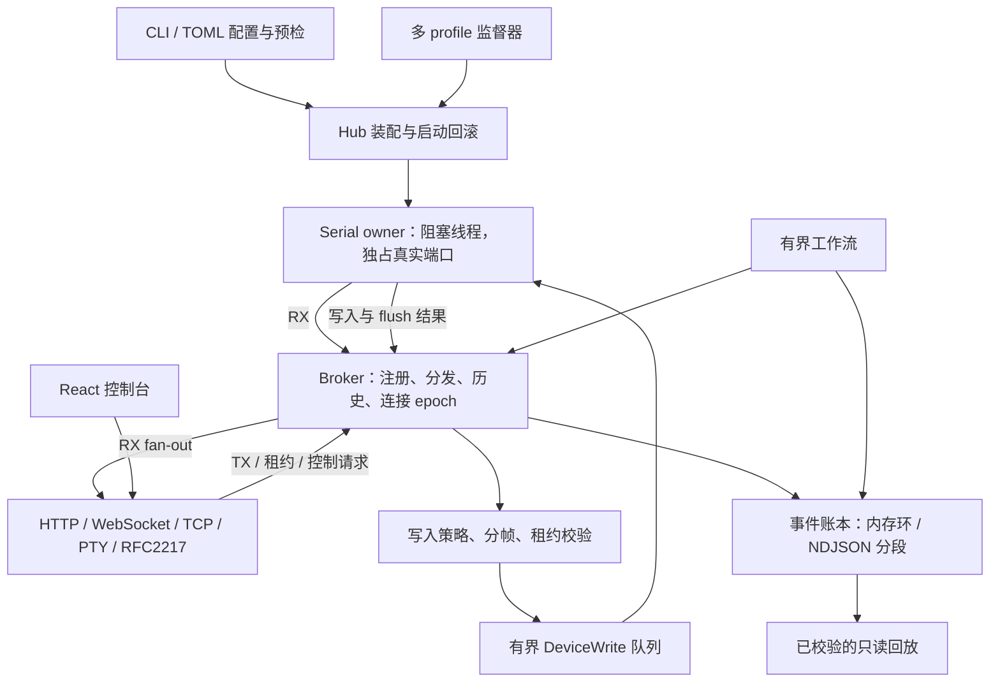

# SerialHub 项目评估与首批优化

> **历史评估档案，非当前验收报告。** 第 3–5 节保留当时实现、待办与测试数量，不能用作 0.0.4 的完成状态。当前功能与架构见 [POSITIONING.md](POSITIONING.md)、[DESKTOP.md](DESKTOP.md)，当前验证入口见 [DOCS.md](DOCS.md)。连接生命周期、HTTPS/WSS、浏览器依赖/门禁、信号批处理及多埠界面已在后续实现；硬件验收仍独立进行。

评估基线：`cc62edf`（v0.0.2 文档基线）。结论基于本仓库源码、现有测试、Linux mock 运行和 Chromium 浏览器实测；未进行市场需求调查或实物串口认证。

后续交付更新：已增加独立连接会话管理、旧请求取消、串行轮询、有限实时流重连、自动发送中断保护、租约过期清理、HTTPS/WSS 与 IPv6 URL、响应式工作台和可重复执行的 Playwright 回归套件；Unix CLI 也已支持 SIGTERM 正常停机与账本封存。下文保留首批评估与当时的测试基线，最新运行说明见 [`OPERATIONS.md`](./OPERATIONS.md)。这些交付不等于已完成真实硬件认证或所有后续优化。

## 1. 是否值得使用和继续开发

**值得，前提是存在“多人或多个程序共享一条设备串口”的需求。**

最适合的场景是：工程师观察设备日志，自动化测试同时收集数据，Agent 在受控窗口内发送命令。单一串口 owner、写入仲裁、不透明写租约、事件证据和有界工作流共同解决这一场景。它们比单独做串口转 TCP 更有价值。

| 使用场景 | 判断 | 原因 |
| --- | --- | --- |
| 嵌入式研发中，终端 + 测试脚本 + Agent 共用 UART | 很适合 | 不必争抢真口，所有写入走统一策略，能记录操作证据 |
| 实验室自动化、设备回归测试、失败现场留存 | 适合试点 | mock、HTTP、工作流、事件账本和只读回放可以组成可复现流程 |
| 多个传统上位机观察同一设备 | 有条件适合 | Unix 可用 PTY；Windows COM-only 软件仍依赖外部虚拟 COM 驱动 |
| 单人偶尔发送几条串口命令 | 收益较小 | 普通串口助手配置更少，无需管理 Hub |
| 面向公网的多租户串口服务 | 当前不适合 | 产品以本机和回环接口为边界，没有租户隔离、账号或云运维体系 |
| 需要认证过的工业设备控制系统 | 需要额外验证 | 主机 flush 不是设备 ACK；mock 不能验证电气行为、驱动或复位时序 |

建议继续聚焦“人和自动化共享设备的可靠基础设施”。优先完善连接生命周期、证据可靠性和真实硬件覆盖，避免同时扩展成通用终端、云平台和驱动项目。

## 2. 架构与模块

| 模块 | 源码 | 职责与边界 |
| --- | --- | --- |
| 命令和配置 | `src/cli.rs`、`src/config.rs` | `share/run/check/supervise`、TOML、串口参数、fan-out 展开和监听策略校验 |
| Hub 装配 | `src/hub.rs` | 创建 Broker/账本，绑定端点，准备 PTY，再启动串口 owner；失败时回滚 |
| 多端口监督 | `src/supervisor.rs` | 检查 profile 之间的资源冲突，协调多 Hub 启停；不在 Hub 之间转发字节 |
| 设备所有者 | `src/serial.rs` | 专用阻塞线程独占串口，处理读写、重连、USB 身份、控制线和维护交接 |
| 共享中枢 | `src/broker.rs` | 客户端注册、RX 队列与背压、历史、epoch、写租约、设备写入确认、状态与指标 |
| TX 策略 | `src/policy.rs` | 按行/帧组装、exclusive/primary_wins、慢客户端策略和写入准入判断 |
| 接入适配器 | `src/client/` | HTTP/WS、TCP、Unix PTY、RFC2217；把各类客户端接入统一 Broker |
| 事件证据 | `src/ledger/{mod,schema,store}.rs` | 有界内存事件环、查询/订阅、SHA-256 链式分段、恢复、校验和导出 |
| 自动化工作流 | `src/workflow/mod.rs` | 受时长、步骤数、匹配模式和证据容量约束的线性操作，不是任意脚本执行器 |
| 离线回放 | `src/replay/mod.rs` | 校验会话后按立即/原始时间/手动方式回放，不持有设备写入句柄 |
| 观察日志 | `src/observe.rs` | 人类可读日志和可选文件记录；与规范化事件账本分工 |
| COM 桥接 | `src/bridge.rs` | 连接已有 COM/tty 与 Hub TCP 端点，不负责安装虚拟 COM 内核驱动 |
| Web 控制台 | `web/src/App.tsx`、各面板、`api/`、协议工具 | 连接管理、发送、日志、协议解析、波形和证据；不直接打开物理串口 |
| 构建和验证 | `.github/workflows/`、`tests/`、`web/tests/` | 前端产物嵌入 Rust，原生和多平台构建、协议及行为回归 |

这套架构适合当前规模：阻塞串口 I/O 与 Tokio 网络端点分离；策略集中而非散落在各协议适配器；回放与真设备写入隔离。没有充分理由现在拆成微服务。

应长期保持三个契约：旧连接 epoch 的排队写入不能发给新设备会话；持有显示名不等于持有写租约；设备发送成功必须区分主机写入确认和业务协议确认。

## 3. 本次已实现的改进

### 事件分页查询

原来的 `Ledger::query` 从事件环起点逐项跳过旧事件，随后又从起点检查 `has_more`。近期小窗口查询也要在账本互斥锁内扫描大量历史，竞争的是串口 RX 追加事件所用的同一把锁。

现在利用事件序号的有序性，以二分定位游标和上界，再在目标范围内迭代，并从当前迭代位置判断后续匹配项。定位成本从线性前缀扫描降为对数级；复杂过滤仍需要扫描请求范围，不能视为所有查询都变成常数时间。

新增测试覆盖淘汰后的过滤分页、上下界、`has_more`、空结果游标和 `u64::MAX`。内存淘汰导致的不完整查询语义保持不变。

微基准条件：65,536 个内存事件，查询最后 200 条，预热 100 次，执行 2,000 次，Linux / Rust 1.99.1 / debug 构建。

| 实现 | 三次耗时 | 中位数 |
| --- | --- | --- |
| 原实现 | 5,510.49 / 5,816.32 / 4,636.78 ms | 5,510.49 ms |
| 新实现 | 144.85 / 160.12 / 114.39 ms | 144.85 ms |

本机 debug 微基准约快 38 倍。这不是串口吞吐、HTTP 延迟或 release 构建的性能承诺。可用 `cargo run --locked --example ledger_query_bench` 重测新实现；基准程序位于 `examples/ledger_query_bench.rs`。

### 前端日志批处理

原来每个接收包都创建 React 状态更新并复制已有日志数组。现在通过固定容量环形缓冲区合并更新，默认每 50 ms 刷新一次，待刷新队列与显示列表各保留最多 2,000 条。时间戳在入队时生成；清空和组件卸载会取消待刷新内容。

这是页面显示窗口，不是完整采集存储。持续高负载时会淘汰旧显示记录；需要完整证据应启用账本持久化。波形和协议面板还会逐包更新，本次没有把这些路径的性能也视为已解决。

### WebSocket 数据准确性

后端的文本帧承载 `ohmyserial.error` 等诊断，原前端把它重新编码后交给设备 RX 日志和协议解析器。现在诊断进入错误日志，不再污染设备数据。

文本显示改为每次连接持有一个流式 UTF-8 decoder，解决中文和 emoji 横跨 WebSocket 二进制帧时出现替换字符的问题。跳过暂停期间的数据时重置 decoder，避免拼接不连续字节。测试遍历所有切分点，并验证逐字节输入。

### RFC2217 连接清理

原监听器直接 `tokio::spawn` 每个连接；停止监听器没有停止已建立的连接。本次先用集成测试复现：Hub 关闭后连接仍在，读取超时。现在由监听器通过 `JoinSet` 持有并回收连接任务，监听器终止会取消其连接，释放 Broker 注册和 socket。相同回归测试已通过。

### 可实际运行的 Vite 开发流程

真实浏览器确认旧文档中的“默认 share + Vite”组合会失败：5173 页面访问 8787 API，默认 Hub 只允许同源，HTTP 被 CORS 拒绝。

新增 `serialhub.dev.toml`：使用 mock 设备，API 仍只绑定回环地址，仅允许 `http://127.0.0.1:5173` 与 `http://localhost:5173` 两个开发来源。中英文 Web README 已改用这个 profile；两个来源都已通过浏览器 HTTP + WS + 发送回显测试。正式部署的默认策略没有放宽。

### 回归门禁与交付产物

CI 的前端检查由仅 build 扩展为 test + lint + build，Rust test/build 使用 `--locked`。更新了仓库追踪的 `web/dist`，因此内嵌控制台包含本次前端修复。也清理了一处冗余导入，并按当前 Clippy 建议使用固定长度分块 API，不改变十六进制解析语义。

## 4. 接下来应优先优化什么

下表是后续实现顺序，尚未实现的项不计入本次完成范围。

| 优先级 | 代码证据与问题 | 建议实现与验收 |
| --- | --- | --- |
| P1 | `App.tsx` 的 metadata 请求没有 session 标识；旧请求和旧 WS 回调有机会覆盖新连接/断开状态 | 提取 `useHubConnection`，引入会话 generation、AbortController、超时和旧回调检查；用延迟响应测试快速切换、断开和重连，切换时清理旧租约 |
| P1 | `api/types.ts` 固定拼接 `http://` / `ws://`，不能完整支持文档所描述的 HTTPS 反向代理控制台 | 明确 endpoint URL 模型及 http/https、ws/wss 映射；兼容已有连接 profile，测试同源 HTTPS、反向代理 Host 和 Origin；不能简单关闭浏览器或服务端校验 |
| P1 | 每客户端队列有界，但 TCP/RFC2217 接入和任务数没有全局连接预算 | 增加可配置连接数/总队列预算，在注册前准入；验证超过上限时拒绝、断开后容量恢复以及慢消费者隔离 |
| P1（部署前） | mock 无法覆盖真实驱动、USB 拔插和控制线；六平台 CI 不能替代硬件 | 按 `RELIABILITY_TEST_MATRIX.md` 建立适配器/系统实测矩阵，记录命令 ACK、拔插、RTS/CTS、handoff 和停机行为 |
| P2 | `Ledger::append` 在账本锁内进行同步存储，开启逐事件 fsync 时串口 owner 可能等待磁盘；这是源码路径上的性能风险，尚未做磁盘压测 | 先量化存储 p95/p99 和 RX gap，再设计有界持久化队列/批量 checkpoint；必须明确内存记录、落盘确认和故障恢复的语义，不能静默改变证据保证 |
| P2 | 完整事件导出和 replay 先载入事件集合，导出还构建完整输出缓冲 | 逐段校验、流式输出、限制并发导出，明确活动会话快照边界；对大捕获、断链、客户端取消和低内存做测试 |
| P2 | `App.tsx` 集中连接、发送、租约、日志和多个解析器；Broker 同时承担 registry、TX 和状态聚合 | 前端按连接、发送、RX 展示提取 hooks；后端分离 registry/fan-out 与 TX/control 状态机，保持统一的设备所有权和现有契约测试 |
| P2 | 波形/协议面板逐包更新，日志仍可能渲染 2,000 行 DOM | 对可视面板做批量发布或降采样，对长日志做虚拟列表；用固定录制流比较主线程耗时、内存与输入响应，不能只比较函数运行时间 |

不建议现在引入数据库、消息队列或微服务来解决上述问题。它们会增加本机安装和故障恢复成本，且不直接解决串口所有权、浏览器状态竞争或驱动兼容性。

## 5. 本次验证

| 检查 | 结果 |
| --- | --- |
| `cargo test --locked --all-targets` | 143 项通过，0 失败、0 忽略；二进制和微基准示例的零测试目标不计入 143 项 |
| `cargo fmt --all -- --check` | 通过 |
| `cargo clippy --locked --all-targets -- -D warnings` | 通过 |
| `cargo build --locked --bins` | 通过，包含兼容命令 |
| `npm test` | 18 项通过，包含本次新增的 6 项前端回归测试 |
| `npm run lint`、`npm run build` | 通过，内嵌资源已更新 |
| `serialhub check -c serialhub.dev.toml` | 通过；随后还实际启动了该配置并验证浏览器功能 |
| Chromium + 实际 Hub | 内嵌页面加载、HTTP/WS 连接、中文逐字节拆包、页面发送/回显、清空、断开均通过 |
| Chromium + 模拟 WS 突发 | 3,000 帧输入后保留 2,000 行，错误帧未进入 RX |
| Chromium + Vite 开发 profile | `127.0.0.1:5173` 和 `localhost:5173` 均通过 HTTP/WS 与发送回显 |

GitHub Actions 的新多平台任务尚未在远端运行；本次也没有执行完整 release 包装、依赖审计或实物串口测试。浏览器实测使用环境预装的 Playwright/Chromium，尚未将其加入项目依赖或 CI 门禁。

本批改动的取舍是保持现有 CLI/API、事件 schema 和设备写入契约，先修复已复现的问题并降低热点路径开销。日志显示最多增加约一个刷新周期的延迟，后台标签页可能受浏览器计时器节流；完整采集仍应依赖事件账本。
