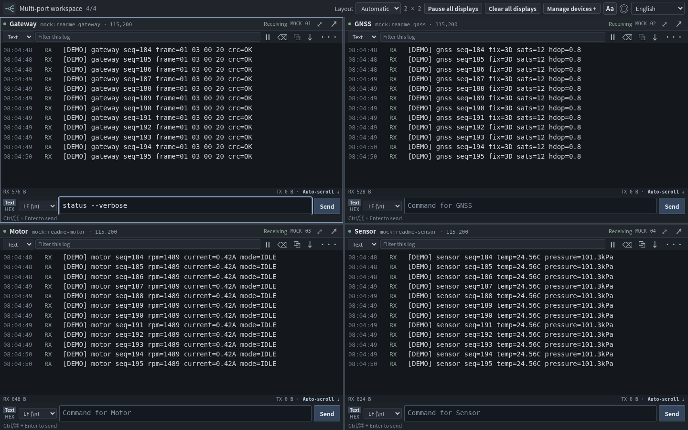
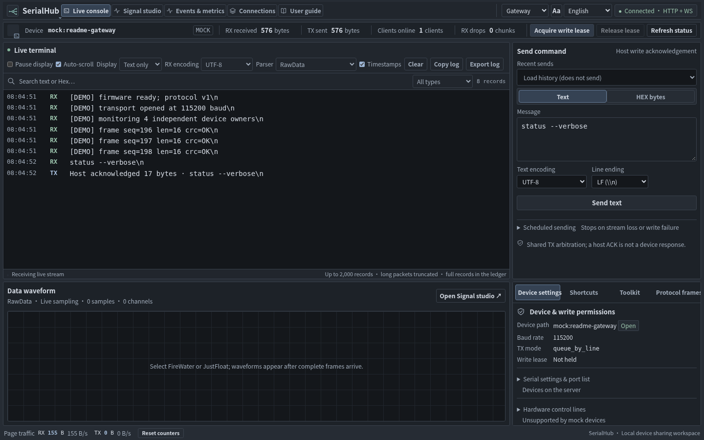
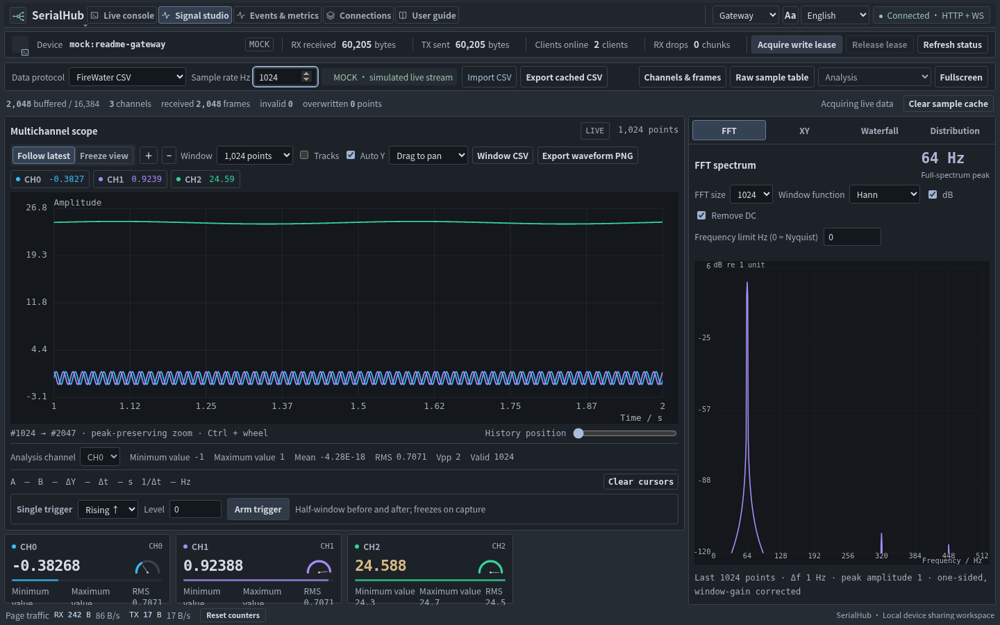
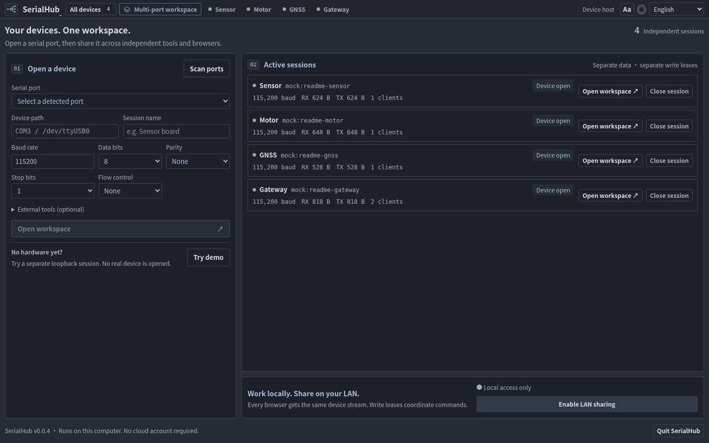

<picture>
  <source media="(prefers-color-scheme: dark)" srcset="assets/brand/serialhub-lockup-dark.svg" />
  <source media="(prefers-color-scheme: light)" srcset="assets/brand/serialhub-lockup-light.svg" />
  
</picture>

<p align="center">
  <a href="README.md"></a>
  <a href="README.zh-CN.md"></a>
  <a href="README.es.md"></a>
  &nbsp; / &nbsp;
  <a href="DESKTOP.md">Primeros pasos</a> · <a href="DOCS.md">Documentación</a> · <a href="https://github.com/tianrking/serialhub/releases">Descargas</a>
</p>

<p align="center">
  <a href="Cargo.toml"></a>
  <a href="LICENSE"></a>
  <a href="DESKTOP.md"></a>
  <a href="https://www.rust-lang.org/"></a>
  <a href="web/package.json"></a>
  <a href="web/package.json"></a>
</p>

<p align="center">
  <a href="Cargo.toml"></a>
  <a href="Cargo.toml"></a>
  <a href="DOCS.md"></a>
  <a href="web/PROTOCOL.zh-TW.md"></a>
  <a href="DOCS.md"></a>
  <a href="DOCS.md"></a>
  <a href="serialhub.example.toml"></a>
</p>

Un espacio de trabajo serie que funciona en tu equipo. Un único propietario abre cada puerto físico; navegadores, pruebas y herramientas comparten RX y coordinan los envíos. Varios dispositivos se depuran en mosaico.

**Código / candidato local actual: 0.0.4.** Las descargas públicas históricas v0.2.3 no incluyen las últimas mejoras de bandeja, mosaico y texto. Consulta [el estado de publicación](RELEASE_NOTES.md).

## El espacio de trabajo



*Código 0.0.4 · Cuatro dispositivos Mock en bucle · Tráfico HTTP/WS real · 1440 × 900. Abre la imagen para verla a tamaño completo.*

<details>
<summary>Ver consola, instrumentos y gestor de dispositivos</summary>

### Consola en vivo

Inspecciona texto o HEX, copia registros y envía comandos con las herramientas de protocolo junto al panel de recepción.



### Estudio de señales

Canales, cursores, espectro e instrumentos en una vista. La captura usa una señal FireWater sintética de 64 Hz; no es una medición de hardware.



### Gestor de dispositivos

Abre dispositivos independientes, configura sus parámetros UART y gestiona cada propietario desde el navegador.



</details>

La interfaz empieza en inglés y ofrece chino tradicional/simplificado, español, francés y árabe RTL. **Aa** ajusta el texto de la interfaz y el registro/editor de envío. Consulta [idiomas](I18N.md), [texto](DISPLAY.md) e [identidad](BRAND.md).

En un paquete verificado de tu plataforma, abre `serialhub-desktop.exe` (Windows), `SerialHub.app` (macOS) o `serialhub-desktop` (Linux). El navegador se abre automáticamente; elige un puerto o prueba la demo sin hardware. No necesitas Node.js ni Rust para usar la aplicación descargada.

[MIT](LICENSE) · Rust · Windows / macOS / Linux · [CI](https://github.com/tianrking/serialhub/actions/workflows/ci.yml)

---

## Tabla de contenidos

- [¿Qué es serialhub?](#qué-es-serialhub)
- [Problema y solución](#problema-y-solución)
- [Funciones](#funciones)
- [Cómo funciona](#cómo-funciona)
- [Soporte de plataformas](#soporte-de-plataformas)
- [Instalación y compilación](#instalación-y-compilación)
- [Inicio rápido](#inicio-rápido)
- [Consola web serie](#consola-web-serie)
- [Cómo usarlo (escenarios)](#cómo-usarlo-escenarios)
- [Configuración](#configuración)
- [CLI](#cli)
- [API HTTP y WebSocket](#api-http-y-websocket)
- [Políticas de TX](#políticas-de-tx)
- [PTY en Unix](#pty-en-unix-macos--linux)
- [Notas para Windows](#notas-para-windows)
- [Seguridad](#seguridad)
- [Estructura del proyecto](#estructura-del-proyecto)
- [Desarrollo](#desarrollo)
- [Alcance de la versión actual](#alcance-de-la-versión-actual)
- [FAQ](#faq)
- [Contribuir](#contribuir)
- [Licencia](#licencia)
- [Etiquetas técnicas](#etiquetas-técnicas)

---

## ¿Qué es serialhub?

**serialhub** es un **hub de puerto serie** pequeño y open source escrito en Rust.

Hace lo siguiente:

1. Abre el **dispositivo serie real** una sola vez (propiedad exclusiva)
2. **Replica el RX** (dispositivo → host) a muchos clientes
3. **Arbitra el TX** (host → dispositivo) para que varios escritores no corrompan tramas en silencio
4. Expone clientes por **TCP**, **HTTP/WebSocket** (pensado para agentes) y **PTY** (herramientas clásicas en macOS/Linux)

Ideal para depuración embebida cuando **un terminal humano y un agente/script de IA deben compartir el mismo UART**.

| Concepto | Valor |
|----------|--------|
| Binario | `serialhub` |
| Repositorio | [github.com/tianrking/serialhub](https://github.com/tianrking/serialhub) |
| Lenguaje | Rust (edition 2021) |
| Licencia | MIT |
| Documentación | [English](./README.md) (por defecto) · [中文](./README.zh-CN.md) · **Español** |
| Arquitectura | [`POSITIONING.md`](./POSITIONING.md) |
| Descarga pública histórica | [v0.2.3](https://github.com/tianrking/serialhub/releases/tag/v0.2.3) |

---

## Problema y solución

### El problema

| Objetivo | Realidad |
|----------|----------|
| Dejar abierto el monitor serie | El puerto ya está ocupado |
| Que un agente lea el mismo log | El segundo proceso no puede abrir el puerto |
| Que ambos envíen comandos | Los bytes se intercalan y el protocolo se rompe |

### La solución

```text
Dispositivo (UART/COM)
        │
        ▼
   ┌──────────┐
   │ serialhub│  ← único proceso que abre el puerto real
   └────┬─────┘
        │
   ┌────┴─────────────────────────────┐
   ▼                ▼                 ▼
  PTY            flujo TCP       HTTP + WebSocket
 (UI host)       (scripts)          (agentes)
```

---

## Funciones

### Funciones de producto

| Función | Descripción | Estado |
|---------|-------------|--------|
| Puerto real exclusivo | Un solo dueño del UART hardware | ✅ |
| Parámetros del puerto | baud, bits, paridad, stop, flow | ✅ |
| Difusión RX | Todos los clientes de lectura reciben datos | ✅ |
| Arbitraje TX | Cola por línea/trama, exclusivo, primary | ✅ |
| Bloqueo de escritura | Propiedad temporal de TX | ✅ |
| Reconexión | Reapertura opcional al desconectar | ✅ |
| Cliente TCP | Flujo de bytes bidireccional | ✅ |
| API HTTP | health / status / endpoints / events / workflows / write / control / handoff / lock | ✅ |
| WebSocket | RX en vivo (+ historial opcional) | ✅ |
| PTY Unix | Serie virtual con symlink | ✅ (macOS/Linux) |
| Log de sesión | Consola + archivo; text/hex | ✅ |
| Consola web serie | Perfiles, finales de línea, comandos rápidos, temporizador, checksums, protocolos, onda y líneas de control | ✅ |
| Event ledger y replay seguro | Evidencia RX/TX/connection/control/gap con ring acotado y replay verificado | ✅ |
| Puerto mock | `mock:demo` sin hardware | ✅ |
| TOML + CLI | `share` / `run` / `check` / `init` / `list-ports` / `status` / `supervise` | ✅ |
| Multi-puerto en un proceso | Varios perfiles reales con detección de colisiones | ✅ |
| RFC2217 | Control serie por red | ✅ |
| Puente COM en Windows | `bridge-com` + par com0com/COM virtual instalado | ✅ |
| COM virtual nativo en Windows | Nivel driver | Driver firmado externo |

### Características técnicas

| Área | Stack |
|------|--------|
| Runtime | Tokio |
| HTTP/WS | Axum |
| Serie | `serialport` + hilo de lectura |
| Config | Serde + TOML |
| Logs | `tracing` + blog de sesión |
| PTY Unix | `nix` openpty |
| Tests | Unitarios + integración (mock) |
| CI | Ubuntu · macOS · Windows |

---

## Cómo funciona

### Plano de datos

```text
Dispositivo ──RX──► Serial Core ──► Broker.broadcast ──► clientes
Cliente ──TX──► Broker.admit(política/lock) ──► Serial Core ──► Dispositivo
```

### Plano de control

- `GET /v1/status` — estado, baud, clientes, dueño del lock, contadores  
- `POST /v1/lock` / `DELETE /v1/lock` — arriendo de escritura  
- `POST /v1/write` — inyectar TX como cliente con nombre  

### Módulos

```text
CLI / Config
    └── Supervisor Hub
            ├── Núcleo serie (open, reconnect, mock)
            ├── Broker (registro, fan-out, cola TX)
            ├── Policy (queue_by_line / exclusive / …)
            ├── Clientes: PTY · TCP · HTTP/WS
            └── Observe (log de sesión, tracing)
```

---

## Soporte de plataformas

| Capacidad | macOS | Linux / Ubuntu | Windows |
|-----------|:-----:|:--------------:|:-------:|
| Serie real | ✅ | ✅ | ✅ |
| TCP | ✅ | ✅ | ✅ |
| HTTP + WebSocket | ✅ | ✅ | ✅ |
| Serie virtual PTY | ✅ | ✅ | — |
| Mock | ✅ | ✅ | ✅ |

**Ubuntu:** instala `build-essential pkg-config libudev-dev` antes de compilar.  
**Windows:** apps que solo listan COM deben usar TCP/WS o un puente externo; PTY es solo Unix.

Para programas antiguos que solo abren COM, usa `bridge-com` con un par creado
por com0com u otro proveedor COM virtual ya instalado:

```powershell
serialhub.exe share COM3 --tcp 1 --tcp-raw --tcp-base 8788
serialhub.exe bridge-com COM13 --tcp 127.0.0.1:8788 --baud 115200
```

Consulta [`WINDOWS_COM_BRIDGE.md`](./WINDOWS_COM_BRIDGE.md) para la instalación
del par y sus límites. El binario reenvía bytes en modo usuario; no instala un
driver kernel ni sustituye la firma del controlador.

---

## Instalación y compilación

### Requisitos

- [Rust](https://rustup.rs/) stable  
- **Ubuntu/Debian:**

  ```bash
  sudo apt update
  sudo apt install -y build-essential pkg-config libudev-dev
  ```

### Compilar desde el código

```bash
git clone https://github.com/tianrking/serialhub.git
cd serialhub
cargo build --release
```

| SO | Binario |
|----|---------|
| Unix | `./target/release/serialhub` |
| Windows | `.\target\release\serialhub.exe` |

```bash
cargo test
./target/release/serialhub --help
```

---

## Inicio rápido (lo más fácil)

**Sin archivo de configuración:**

```bash
./target/release/serialhub list-ports
./target/release/serialhub share /dev/cu.usbmodem14101 --baud 115200
./target/release/serialhub share /dev/ttyUSB0 --pty 3
./target/release/serialhub share COM3 --tcp 2          # Windows
./target/release/serialhub share mock:demo
```

Por defecto en macOS/Linux: **2 series virtuales (PTY)** + TCP + WebSocket.  
Al arrancar imprime una **tarjeta de conexión** (SERIAL / TCP / WS).

También puedes fijar los parámetros completos al iniciar: `--baud`,
`--data-bits`, `--parity`, `--stop-bits` y `--flow-control` (`none`,
`software` o `hardware`). `run` acepta los mismos flags como overrides
temporales sin modificar el TOML.

---

## Consola web serie

`share --ui` o `run --ui` sirve la consola embebida en la misma dirección
que la API, normalmente **http://127.0.0.1:8787/**. Incluye perfiles de
sesión, finales de línea y `Ctrl/⌘+Enter`, comandos rápidos, envíos
temporizados (mínimo 50 ms), checksums `SUM8`/`XOR8`/`CRC16`, log de texto o
Hex con pausa/scroll/exportación, parseo local `RawData`/`FireWater`/
`JustFloat` con onda, y control DTR/RTS/BREAK.

Todos los envíos siguen pasando por `POST /v1/write`; los parámetros físicos
del puerto se fijan al iniciar por CLI/TOML. La guía de build y la tabla de
funcionalidades están en [`web/README.md`](./web/README.md), y el contrato
detallado en [`web/PROTOCOL.zh-TW.md`](./web/PROTOCOL.zh-TW.md).

---

## Cómo usarlo (escenarios)

### Idea central: un puerto real → muchos extremos en paralelo

```text
                 ┌─ PTY /tmp/serialhub-v0  → GUI serie #1
                 ├─ PTY /tmp/serialhub-v1  → GUI #2 / agente por serie virtual
 UART real ──► hub ┼─ TCP :8788            → muchos scripts a la vez
                 ├─ TCP :8789            → más herramientas
                 └─ WS  /v1/stream        → muchos agentes a la vez
```

Todos reciben el **mismo RX en vivo**. El TX se arbitra (política/lock).

Usa **`[fanout]`** para crear en bloque, o `[[clients]]` uno a uno.

```bash
curl -s http://127.0.0.1:8787/v1/endpoints
```

### A — Varias apps host + agente

```toml
[fanout]
pty_count = 2
pty_link_prefix = "/tmp/serialhub-v"
tcp_count = 1
tcp_base_port = 8788
```

### B — Solo scripts / CI

`tcp_count = 2` + API; sin PTY.

### C — Demo sin hardware

`path = "mock:demo"`.

### D — Lock exclusivo

El ejemplo requiere `curl` y `jq`. Guarda el token opaco; el nombre del cliente no es una credencial.

```bash
LEASE_TOKEN="$(curl -s -X POST http://127.0.0.1:8787/v1/lock \
  -H 'content-type: application/json' \
  -d '{"as_client":"agent"}' | jq -r '.lock.lease_token')"
curl -s -X POST http://127.0.0.1:8787/v1/write \
  -H 'content-type: application/json' \
  -d "{\"text\":\"ATI\",\"lease_token\":\"$LEASE_TOKEN\"}"
curl -s -X DELETE http://127.0.0.1:8787/v1/lock \
  -H 'content-type: application/json' \
  -d "{\"lease_token\":\"$LEASE_TOKEN\"}"
```


---

## Configuración

Ejemplo: [`serialhub.example.toml`](./serialhub.example.toml)

```toml
[real]
path = "mock:demo"
baud = 115200
databits = 8
parity = "none"
stopbits = 1
flow = "none"
reconnect = true

[tx]
mode = "queue_by_line"     # queue_by_line | queue_by_frame | exclusive | primary_wins
primary = "ui"
write_lock_ms = 3000
slow_client = "drop_oldest"

[api]
bind = "127.0.0.1:8787"
enabled = true
can_read = true
can_write = true
can_control = false # true habilita DTR/RTS/BREAK y handoff; cada petición necesita lease

[[clients]]
type = "tcp"
name = "tcp"
bind = "127.0.0.1:8788"

[[clients]]
type = "websocket"
name = "agent"
history_bytes = 65536

# solo macOS / Linux
# [[clients]]
# type = "pty"
# name = "ui"
# link = "/tmp/serialhub-ui"

[log]
mirror_console = true
format = "hex+text"
```

| Campo | Significado |
|-------|-------------|
| `real.path` | Ruta del dispositivo o `mock:nombre` |
| `tx.mode` | Política de escritura concurrente |
| `api.bind` | Dirección HTTP/WS (preferir localhost) |
| `api.token_env` | Nombre de la variable de entorno con el Bearer; no se guarda en TOML |
| `api.cors_origins` | Lista exacta de Origin; vacío = same-origin y `*` se rechaza |
| `api.can_control` | Habilita DTR/RTS/BREAK y handoff; cada petición necesita un lease |
| `can_read` / `can_write` | Permisos por cliente |

---

## CLI

```bash
serialhub run -c serialhub.toml    # iniciar hub
serialhub check -c serialhub.toml  # validar el perfil sin abrir el puerto serie
serialhub share <device> [opciones de serie/endpoint]
serialhub supervise -c board-a.toml -c board-b.toml
serialhub init [-o file]           # config de ejemplo
serialhub list-ports               # listar puertos
serialhub status [--api URL]       # consultar estado
serialhub bridge-com COM13 --tcp 127.0.0.1:8788  # par COM existente -> TCP
```

Añade `--tcp-raw` a `share` para protocolos binarios o `bridge-com`; evita el
ensamblado por delimitador y conserva cada lectura TCP como una unidad TX atómica acotada.

`share` es el arranque directo de un dispositivo real o `mock:nombre`; `run`
usa un TOML y permite overrides temporales de los parámetros de línea y
endpoints. `supervise` levanta varios perfiles con detección de colisiones.

```bash
RUST_LOG=debug serialhub run -c serialhub.toml
```

---

## API HTTP y WebSocket

**Base:** `http://127.0.0.1:8787`

La API y el WebSocket dedicado solo escuchan en loopback. Si configuras
`api.token_env`, todas las rutas `/v1/*` salvo `/v1/health` requieren
`Authorization: Bearer <token>`; el token no debe aparecer en TOML, URL ni logs.
Para una página alojada en otro origen, usa `api.cors_origins` con orígenes
exactos y recuerda que WebSocket valida también `Origin`.

| Método | Ruta | Descripción |
|--------|------|-------------|
| `GET` | `/v1/health` | Liveness |
| `GET` | `/v1/status` | Puerto, clientes, lock, stats |
| `GET` | `/v1/clients` | Lista de clientes |
| `GET` / `POST` | `/v1/serial/settings` | Consultar/cambiar parámetros; POST requiere permiso de control y lease |
| `GET` | `/v1/serial/ports` | Hub host serial-port inventory |
| `GET` | `/v1/endpoints` | PTY/TCP disponibles y estado |
| `GET` | `/v1/events` | Historial paginado de eventos |
| `GET` | `/v1/events/status` | Estado del ledger de eventos |
| `GET` | `/v1/events/export` | Exportar eventos como JSONL |
| `GET` | `/v1/metrics` | Métricas Prometheus sin etiquetas controladas por usuarios |
| `WS` | `/v1/events/stream` | Stream de eventos en vivo |
| `POST` | `/v1/workflows/run` | Ejecutar workflow acotado |
| `POST` | `/v1/control` | DTR/RTS/BREAK mediante el dueño serie |
| `POST` | `/v1/handoff` | Solicitar entrega controlada |
| `POST` | `/v1/handoff/resume` | Reanudar después de una entrega |
| `POST` | `/v1/write` | Enviar text o hex al dispositivo |
| `POST` | `/v1/lock` | Adquirir lock de escritura |
| `DELETE` | `/v1/lock` | Liberar lock |
| `WS` | `/v1/stream` | Stream RX en vivo |

### Write

```bash
curl -s -X POST http://127.0.0.1:8787/v1/write \
  -H 'content-type: application/json' \
  -d '{"text":"AT","newline":true,"as_client":"agent"}'

curl -s -X POST http://127.0.0.1:8787/v1/write \
  -H 'content-type: application/json' \
  -d '{"hex":"41 54 0d 0a","as_client":"agent"}'
```

Las escrituras HTTP son atómicas y `ok: true` solo confirma `write_all` +
`flush` del host, no el ACK del dispositivo. Con un lease activo hay que
enviar su `lease_token`; el nombre `as_client` solo sirve para auditoría.
Activa `api.can_control = true` para DTR/RTS/BREAK y usa primero un lease;
mock no tiene líneas físicas y RTS se rechaza con flow control hardware.
Para que una herramienta externa abra temporalmente el puerto real, sigue el
handoff acotado de [`HANDOFF.md`](./HANDOFF.md).

### WebSocket

```text
ws://127.0.0.1:8787/v1/stream
```

### TCP

```bash
nc 127.0.0.1 8788
```

### Agente mínimo en Python

```python
import json, urllib.request

req = urllib.request.Request(
    "http://127.0.0.1:8787/v1/write",
    data=json.dumps({"text": "status", "newline": True}).encode(),
    headers={"content-type": "application/json"},
    method="POST",
)
print(urllib.request.urlopen(req).read().decode())
```

---

## Políticas de TX

| Modo | Comportamiento | Uso típico |
|------|----------------|------------|
| `queue_by_line` **(defecto)** | Espera `\n` y envía la línea completa | Texto / AT / CLI |
| `queue_by_frame` | Espera un delimitador | Tramas binarias simples |
| `exclusive` | Solo con lock activo | Flash / operaciones críticas |
| `primary_wins` | Prefiere `tx.primary` | Humano en el bucle |

Con **write lock** activo, solo el dueño puede hacer TX. Expira por tiempo, release o desconexión.

`slow_client = drop_oldest` protege la lectura en tiempo real del puerto real.

---

## PTY en Unix (macOS / Linux)

```toml
[[clients]]
type = "pty"
name = "ui"
link = "/tmp/serialhub-ui"
can_write = true
can_read = true
```

Abre `/tmp/serialhub-ui` en minicom, screen, Serial Studio, etc.

> El baud real lo controla la sección `[real]` del hub. Algunas apps fallan en ioctls de baud sobre PTY; el flujo de datos suele seguir funcionando.

---

## Notas para Windows

| Necesidad | Usar |
|-----------|------|
| Agente / automatización | HTTP + WebSocket ✅ |
| Flujo simple | TCP `127.0.0.1:8788` ✅ |
| Hardware | `path = "COM3"` ✅ |
| UI antigua solo COM | `bridge-com` con com0com u otro proveedor instalado |
| `type = "pty"` | No soportado |

---

## Seguridad

- Por defecto solo **localhost** (`127.0.0.1`)  
- Escribir al serie es tocar hardware (reset, comandos peligrosos)  
- Puedes configurar Bearer mediante `api.token_env`; aun así HTTP/WS/TCP en claro solo se pueden enlazar a loopback. Para acceso remoto usa un túnel SSH o un reverse proxy TLS
- Los logs pueden contener secretos del stream del dispositivo  

---

## Estructura del proyecto

```text
serialhub/
├── README.md           # English (por defecto)
├── README.zh-CN.md     # 简体中文
├── README.es.md        # Español
├── POSITIONING.md
├── serialhub.example.toml
├── web/README.md       # guía de la consola web embebida
├── src/ ...
└── tests/
```

---

## Desarrollo

```bash
cargo test
cargo run -- run -c serialhub.example.toml
cargo fmt
cargo clippy
```

CI: Ubuntu · macOS · Windows.

---

## Alcance de la versión actual

El código/candidato local actual es **0.0.4**; la descarga pública histórica es **v0.2.3**. Las capacidades siguientes corresponden al código actual: incluye el hub, TX confiable y leases,
PTY en Unix, TCP, HTTP/WebSocket, RFC2217, supervisión de varios perfiles,
ledger de eventos con replay seguro, identidad USB, handoff acotado, métricas
Prometheus y consola web integrada, el espacio de
depuración en una pantalla, análisis de señales y seis idiomas configurables.
Consulta [paquetes y verificación de publicación](./RELEASING.md).

No promete un controlador virtual COM de kernel para Windows, UDP, emulación
completa de terminal, un motor de scripts programable, SaaS en la nube ni
certificación de hardware para todos los adaptadores y dispositivos. Consulta
[`POSITIONING.md`](./POSITIONING.md) para la matriz de plataformas, el contrato
de seguridad/despliegue, el mapa de documentación y el límite HIL.

---

## FAQ

**¿Pueden escribir dos clientes a la vez?**  
No como bytes intercalados. Por defecto se encolan líneas completas; el lock da ventanas exclusivas.

**¿El agente necesita un COM virtual?**  
No. Prefiere WebSocket + HTTP.

**¿Por qué el baud en el PTY no cambia el dispositivo?**  
El hub es dueño de la configuración real del puerto.

**¿Es solo un sniffer?**  
No. Es un **hub interactivo de compartición** con control de TX.

**¿Mock necesita hardware?**  
No.

---

## Contribuir

Issues y PRs: https://github.com/tianrking/serialhub

Alinea los cambios con [`POSITIONING.md`](./POSITIONING.md).

---

## Licencia

[MIT](./LICENSE) © contribuidores de serialhub

---

## Etiquetas técnicas

`serial` · `uart` · `puerto-com` · `tty` · `serial-hub` · `multiplexor` · `compartir-puerto` · `embebido` · `depuración` · `agente-ia` · `websocket` · `http-api` · `tcp` · `pty` · `tokio` · `axum` · `rust` · `multiplataforma` · `macos` · `linux` · `windows` · `toml` · `mit` · `serialhub`

---

<p align="center">
  <a href="./README.md">English</a> ·
  <a href="./README.zh-CN.md">简体中文</a> ·
  <a href="./README.es.md">Español</a>
  <br/>
  <sub>Un puerto. Acceso compartido.</sub>
</p>
