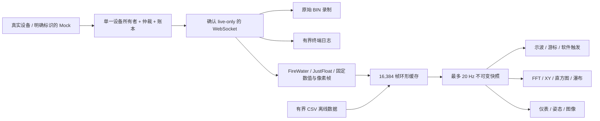

# VOFA+ 常用内置功能对照与信号工作区

本轮按用户确认的“先对齐常用内置功能”推进。SerialHub 保留串口调试工作台，新增独立的“信号仪表”导航。界面提供分析、仪表与控制、全部仪表三种布局，适配桌面和窄屏，并支持全屏查看。

这是一套可实际使用的信号可视化实现，不是 VOFA+ 所有发行版本的完整克隆。当前云环境访问 VOFA+ 官网文档返回 HTTP 403，无法逐个版本核验全部内置控件与插件接口；下表仅列出已有代码和验证覆盖的能力。

## 能力对照

| 常用能力 | SerialHub 当前实现 | 验收边界 |
| --- | --- | --- |
| FireWater CSV | UTF-8 流式解码、可选标签、跨包保留半帧、最多 64 通道 | 空值、NaN/非法字段保留缺口，不会让后续通道左移；超长行丢弃至换行恢复 |
| JustFloat | Little Endian float32 + `00 00 80 7f` 帧尾 | 保留 NaN 的通道位置；正无穷与协议帧尾相同，不能当普通数据发送 |
| RawData | 原始终端、BIN 录制，以及独立的自定义数值帧模式 | 不把任意二进制自动猜成数值协议 |
| 自定义数值帧 | float32/64、int/uint8/16/32，大小端、固定通道数、可选帧头 | 无校验、转义、动态长度或脚本执行；空帧头丢字节后需要手动重同步 |
| 多通道曲线 | 最多 64 通道采集、16 条曲线同屏；名称、颜色、单位、增益、偏移 | 单一浏览器缓存 16,384 帧，满后覆盖最旧帧；不是无限或百万点存储 |
| 示波交互 | 跟随/冻结、缩放、拖动平移、历史位置、键盘左右移动、自动/手动 Y、独立分轨 | 冻结画面不停止实时接收；分轨每个通道独立自动量程 |
| 游标测量 | A/B、通道值、ΔY、Δt、1/Δt | 不插值，读实际采样点；时间依赖用户设置的设备采样率 |
| 单次触发 | 分析通道、上升/下降沿、电平、约半窗前触发及半窗后触发，捕获后冻结 | 浏览器软件触发；没有采到的前触发历史不会被补造，不是硬件实时触发 |
| 统计 | 有效点数、最小/最大、均值、RMS、峰峰值 | 统计跳过非有限值；FFT 不会把这些点删掉再拼成连续波形 |
| FFT | 256–4096 点，Hann/Rectangular、去直流、单边幅度谱、线性/dB、频率上限、全谱主峰 | 使用同一视图终点之前的独立 FFT 窗；校正窗函数相干增益，dB 相对 1 个工程单位，不是 dBm 或硬件 dBFS |
| 频谱瀑布 | 最近 64 个重叠窗口、¼ 窗步进、固定 −100…0 dB 色标 | 记录浏览器实际分析到的窗口；高速突发期间可能跳过中间窗口，不能视为完整 STFT 归档 |
| XY | 任意两通道同帧关联、自动范围、轨迹与最新点 | 最多约 2,000 个绘制点，保留缺口；没有三维点云或任意模型导入 |
| 数字/仪表/条形 | 前 8 个可见通道的数值、半圆仪表、量程条、超范围提示、Min/Max/RMS | 仪表量程独立配置；不是自动判断电压、电流等物理单位 |
| 数值分布 | 当前窗口 24 桶直方图 | 非有限值不计入 |
| 姿态 | 三通道映射、角度/弧度、CSS 3D 立方体，ZYX 欧拉旋转 | 显示设备提供的角度，不执行 IMU 融合或姿态估计 |
| 图像 | GRAY8、RGB565 LE、RGB888，宽高 1–512、可选帧头、完整帧显示、冻结、适应画布、PNG 保存 | 固定长度原始像素协议；不兼容未经说明的 JPEG/MJPEG 或 VOFA 私有图像插件 |
| 参数控件 | 可配置模板、滑块/数值输入、量程、步长和快捷命令按钮 | 调整不自动发送；点击后走现有写入门禁和租约；主机 ACK 不等于设备执行反馈 |
| 数据导出 | 原始采样 CSV、当前窗口 CSV、实际示波图 PNG、图像 PNG | 只导出有界缓存/当前窗口；原始字节保存使用工作台中的 BIN 录制 |
| 离线回放 | CSV 导入、暂停/播放/倍速/单步/位置拖动，离线分析不写设备 | 最多 8 MiB/16,384 帧/64 通道；宽表导出超限时须按窗口分段导入，不是磁盘无限流式回放 |
| 配置保存 | 浏览器本地持久化、带版本 JSON 导入导出，通道、帧配置、布局、采样率和参数控件设置 | 不包含 Hub 访问令牌、租约或会话数据；不是 VOFA 私有工程格式 |

## 数据与计算约定

- 所有曲线、统计和频谱使用同一份有界原始采样缓存。工程值 = 原始值 × 增益 + 偏移。
- 原始数值或校准结果无效时显示缺口/`—`，不插入零。低频重绘不会改变帧的顺序。
- 时间轴使用 `采样序号 / 设备采样率`。串口、TCP、WebSocket 的到包时间不等于设备采样时刻；接收时间另存为 `received_at_ms`。
- FFT 要求连续索引和连续有效值。缺失、错位、非均匀采样不能靠删除坏点来“修正”频率。
- CSV 导出保留**原始值**，而不是已校准工程值。首行声明采样率与 `calibration=raw`，随后为索引、推算时间、接收时间和通道列。
- 导入自身 CSV 时检查时间列的均匀采样关系，也可从时间列推算采样率；非均匀时间列会拒绝进入 FFT。普通 CSV 的所有列都作为数值通道，允许首行列名；没有时间元数据时须由用户确认采样率。
- 纯数字行或 `label:1,2,3` 都可作为 FireWater。该协议没有携带 CRC 和硬件时钟，本工具不能据此保证 UART 未丢帧或采样时钟准确。

## 架构与性能边界



- 协议解析、缓存和数学在 `web/src/signals` 中独立实现，可以不依赖 React 验证。终端“暂停显示”不再影响信号采集。
- 主波形直接从采样计算每桶极值，避免为每个通道的每个采样分配 SVG 点；16,384 点连续曲线的单通道绘制通常小于 1,300 个顶点，显式缺口保留。
- 无关 WebSocket 历史包不进入实时信号计算。检测到设备连接代次变化、协议切换或实时流重连时重置解析边界。硬件状态通过轮询检测，检测之前仍可能收到连接切换期间的数据；不能将此字节流视为严格无缺口的跨重连测量。CSV 回放与实时源隔离，回放期间仪表发送控件禁用。
- 20 Hz 是快照通知上限，**不是保证 20 FPS 或硬件采样能力**。显示暂停、浏览器节流、CPU、USB、网络与队列丢弃仍会影响实时性。极限吞吐需在目标设备上实测。
- 参数控件复用已有页面级 TX 门禁：文件/轮发任务进行中不能插入控件写入；失败不会自动重发。

## 仍未完成的范围

- VOFA+ 各版本的任意插件 ABI、自定义脚本、所有私有工程文件、所有内置控件细节的逐项认证。
- 自由拖放/停靠和任意尺寸控件编辑器（当前是三种响应式布局），多独立绘图区、多 Y 轴标尺、连续/自动触发与复杂触发逻辑。
- 原生 UDP 数据源、任意远程 TCP 客户端模式；当前沿用 Hub 的串口及 HTTP/WS/TCP/RFC2217/PTY 共享架构，不能把已有 TCP 共享宣传成完整网络采集驱动。
- Web Worker/OffscreenCanvas、百万点绘图、无界写盘、压缩视频解码、三维点云/任意模型。
- ADC 计量校准、硬件触发、跨设备时钟同步、真实高波特率长稳测试与 USB/Windows 驱动验收。

## 验证

单元验证使用已知双音输入检查 FFT 频率/幅值、DC/Nyquist 和校准，覆盖统计稳定性、通道缺口、分片、环形覆盖、帧头恢复、RGB565 像素与 CSV/配置。浏览器测试使用实际 Mock Hub 验证实时示波、独立采集、FFT、冻结/缩放/游标/触发、原始图像像素、参数写入、CSV 回放、配置持久化及 16 通道满缓存。

```sh
npm --prefix web test
npm --prefix web run lint
npm --prefix web run build
PLAYWRIGHT_CHROMIUM_EXECUTABLE=/usr/bin/chromium npm --prefix web run test:e2e
cargo test --locked
cargo clippy --locked --all-targets -- -D warnings
cargo build --locked --release --bins
```

发布二进制嵌入 `web/dist`，必须先构建网页，再构建 Rust。截图中的 Mock 波形、文件和图像都是经过实际收发链路生成的演示数据，不代表真实硬件测试。
